# Advanced Weather Data Analysis

An exploratory weather data analysis project using Python, Pandas, NumPy, and Matplotlib. The project examines weather measurements through statistical summaries, time-series analysis, and data visualizations.

## Table of Contents

- [Project Overview](#project-overview)
- [Dataset](#dataset)
- [Tools and Technologies](#tools-and-technologies)
- [Project Objectives](#project-objectives)
- [Data Visualizations and Analysis](#data-visualizations-and-analysis)
- [How to Run](#how-to-run)
- [Limitations](#limitations)
- [Conclusion](#conclusion)

## Project Overview

This project applies exploratory data analysis (EDA) techniques to weather data. It investigates numerical distributions, relationships between variables, seasonal patterns, and changes over time.

The visualizations are designed to make the dataset easier to understand and to support further data-driven investigation.

## Dataset

The analysis uses the following dataset columns:

| Column | Description |
|---|---|
| `date` | Date associated with each weather observation |
| `precipitation` | Recorded precipitation measurement |
| `temp_max` | Recorded maximum temperature |
| `temp_min` | Recorded minimum temperature |
| `wind` | Recorded wind measurement |
| `weather` | Recorded weather category |

The units and measurement conventions depend on the source dataset.

## Tools and Technologies

- **Python** — Core programming language
- **Pandas** — Data manipulation and analysis
- **NumPy** — Numerical operations
- **Matplotlib** — Data visualization
- **Jupyter Notebook / Google Colab** — Interactive analysis

## Project Objectives

- Explore and summarize weather data.
- Analyze numerical distributions and statistical relationships.
- Investigate precipitation, temperature, and wind over time.
- Compare temperature patterns across seasons and weather categories.
- Communicate findings through clear visualizations.

## Data Visualizations and Analysis

Each visualization below includes its purpose, an explanation of what to examine, and the corresponding figure.

### Correlation Heatmap

**Purpose:** Examines the strength and direction of relationships between numerical weather variables.

**Key Insight:** Use the annotated correlation values to identify positive, negative, or weak relationships. Correlation does not establish causation.

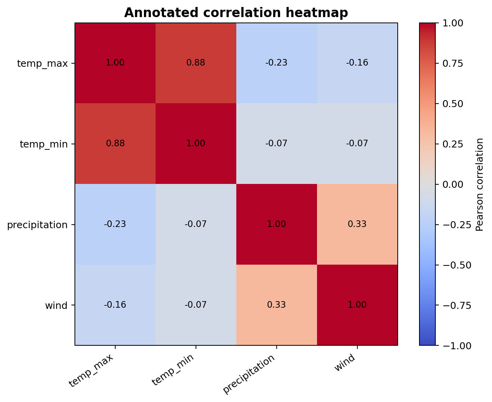

---

### Correlation Matrix

**Purpose:** Provides a numerical overview of correlations among the numerical weather features.

**Key Insight:** Compare the correlation coefficients to understand which variables tend to vary together.

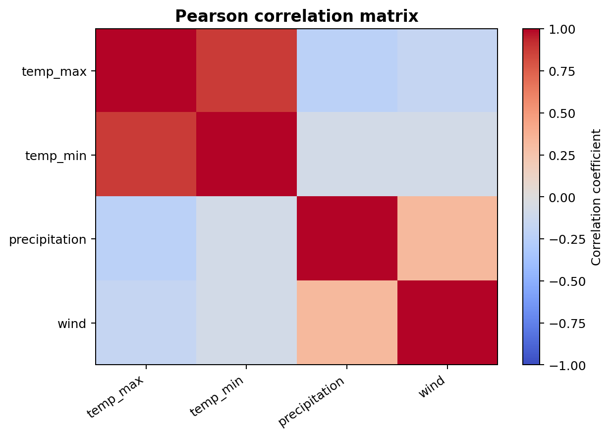

---

### Distribution of Precipitation

**Purpose:** Explores how precipitation measurements are distributed throughout the dataset.

**Key Insight:** Inspect the distribution for skewness, common values, and potentially unusual observations.

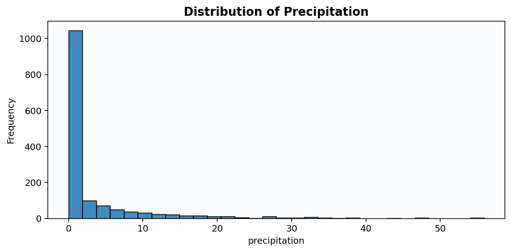

---

### Distribution of Maximum Temperature

**Purpose:** Examines the distribution and variability of daily maximum temperature measurements.

**Key Insight:** The shape and spread of the distribution help describe typical values and possible extreme observations.

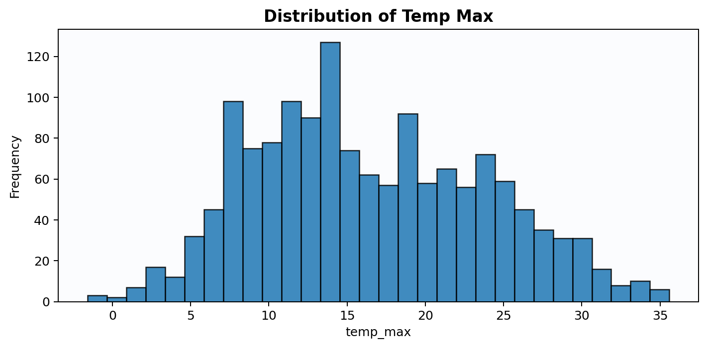

---

### Distribution of Minimum Temperature

**Purpose:** Explores the distribution of recorded minimum temperatures.

**Key Insight:** Review the distribution's spread and shape to understand variation in minimum temperature readings.

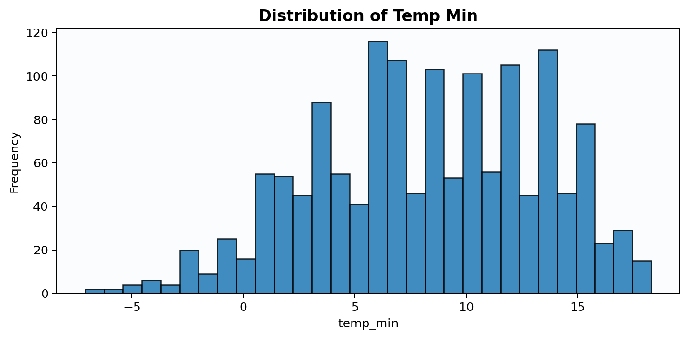

---

### Distribution of Wind

**Purpose:** Analyzes the distribution of recorded wind measurements.

**Key Insight:** Examine common wind values, variability, and any potentially unusual measurements.

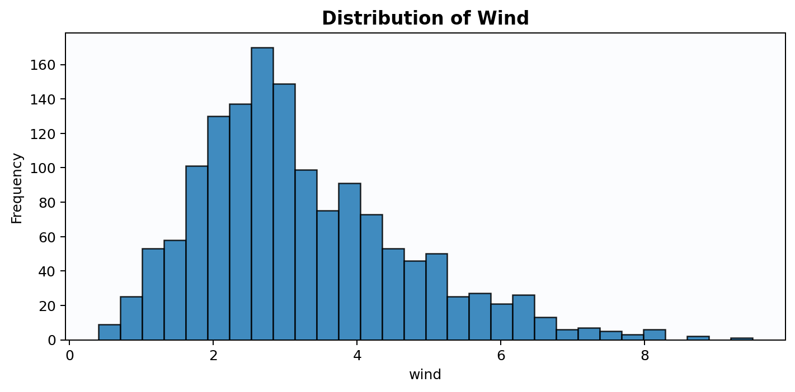

---

### Maximum Temperature by Weather Category

**Purpose:** Compares maximum temperature distributions across the recorded weather categories using a box plot.

**Key Insight:** Compare medians, interquartile ranges, and potential outliers across categories.

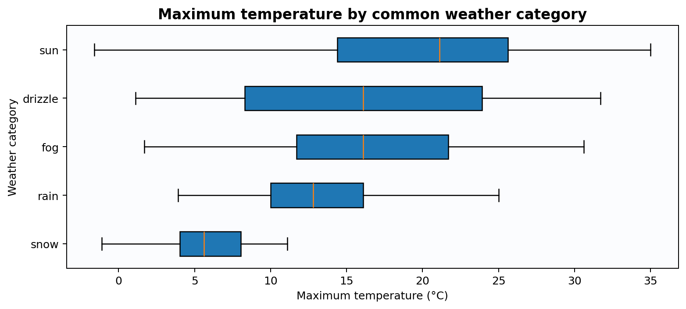

---

### Minimum vs. Maximum Temperature

**Purpose:** Uses a hexbin plot to explore the relationship between minimum and maximum temperatures.

**Key Insight:** The hexagonal bins show where observations are concentrated and help reveal the overall relationship.

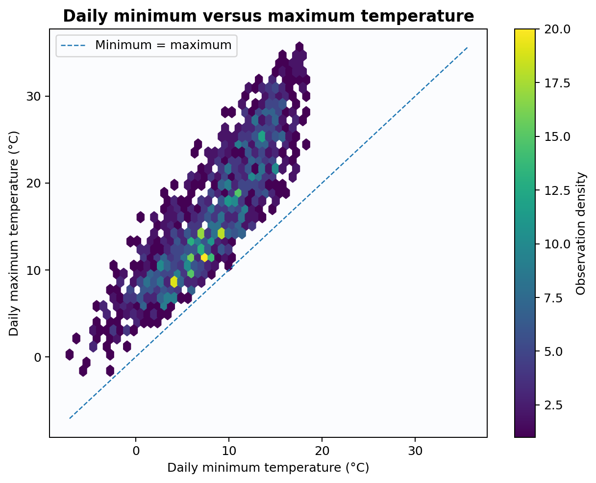

---

### Numeric Scatter Matrix

**Purpose:** Displays pairwise relationships between numerical weather variables.

**Key Insight:** Use the individual plots to explore associations, patterns, clusters, and potential outliers.

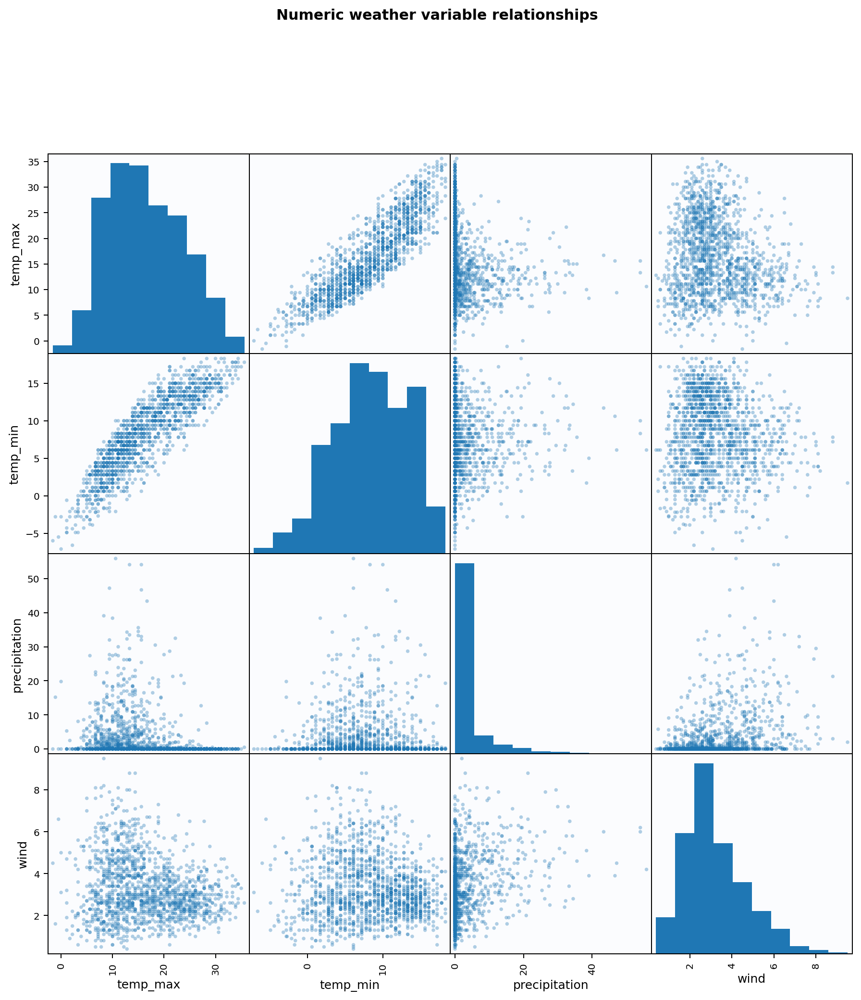

---

### Seasonal Maximum Temperature

**Purpose:** Explores maximum temperature patterns across seasons.

**Key Insight:** Compare the seasonal values to assess differences in maximum temperature across seasons.

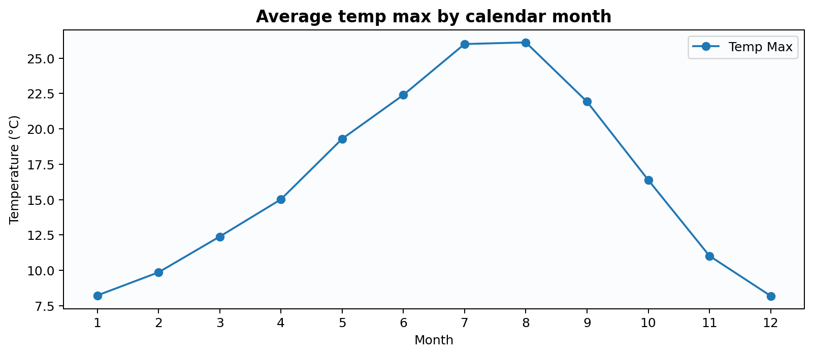

---

### Seasonal Minimum Temperature

**Purpose:** Explores how minimum temperatures vary across seasons.

**Key Insight:** Compare seasonal values to investigate changes in minimum temperature throughout the year.

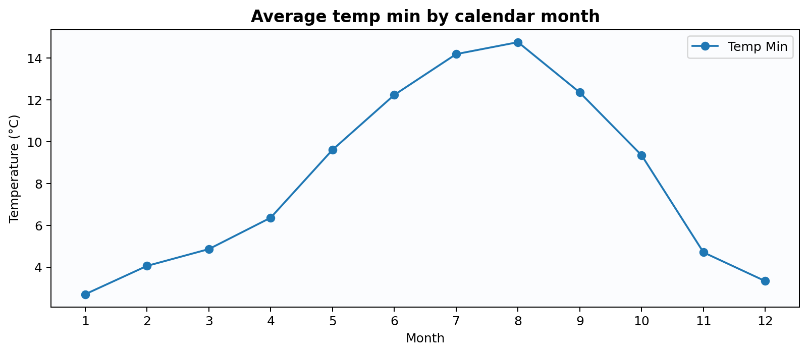

---

### Precipitation Time Series

**Purpose:** Visualizes precipitation measurements over time.

**Key Insight:** Inspect temporal fluctuations and periods of relatively higher or lower precipitation.

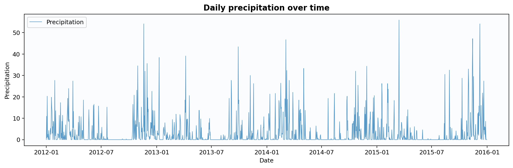

---

### Maximum Temperature Time Series

**Purpose:** Tracks changes in maximum temperature over time.

**Key Insight:** Examine temporal variation and possible recurring or longer-term patterns.

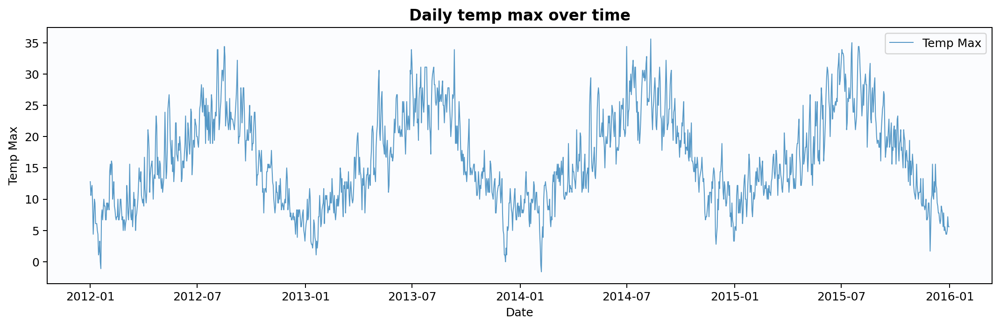

---

### Minimum Temperature Time Series

**Purpose:** Tracks changes in minimum temperature over time.

**Key Insight:** Explore temporal variation and compare the pattern with the maximum temperature time series.

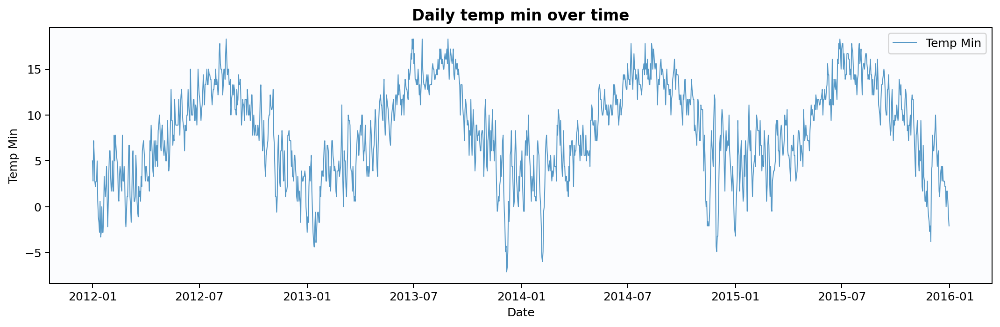

---

### Wind Time Series

**Purpose:** Visualizes changes in recorded wind measurements over time.

**Key Insight:** Examine fluctuations and periods of relatively higher or lower wind measurements.

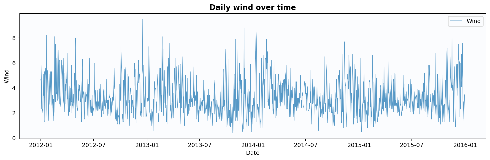

---

### Weather Category Frequency

**Purpose:** Shows the frequency of observations in each weather category.

**Key Insight:** Compare category counts to determine which weather conditions occur most and least frequently in the dataset.

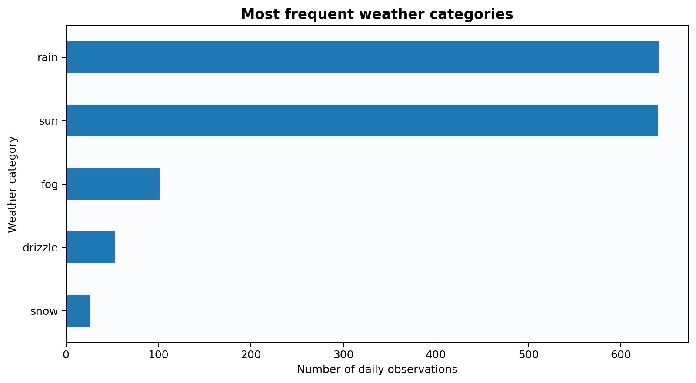

---

### Three-Dimensional Weather Feature Space

**Purpose:** Visualizes observations across three numerical features in a three-dimensional feature space.

**Key Insight:** Inspect the distribution of observations for visible groupings, separation, or patterns.

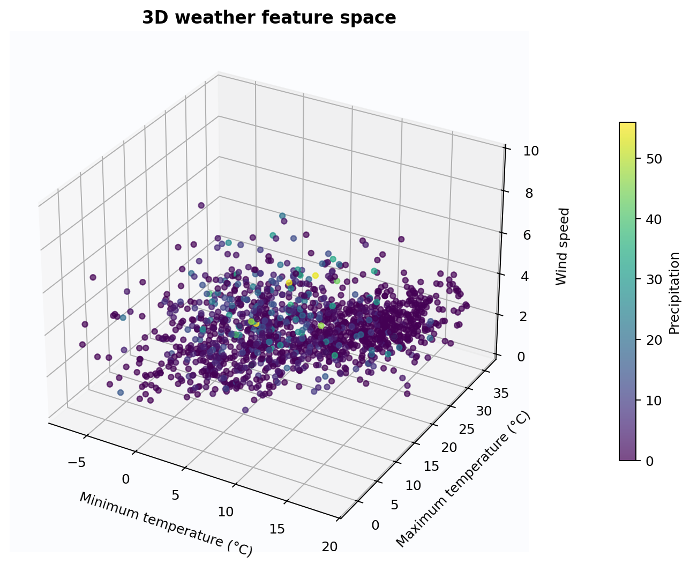

---

## How to Run

1. Clone or download this repository.
2. Open `weather_analysis_advanced.ipynb` in Google Colab or a compatible Jupyter environment.
3. Install any required dependencies if they are not already available.
4. Run the notebook cells in order.

## Limitations

The explanations above describe the purpose of each visualization and what it can help investigate. They do not claim specific statistical findings without verifying the actual results. Observed patterns depend on the dataset, data quality, and analysis.

## Conclusion

This project demonstrates a structured workflow for exploratory weather data analysis, combining data manipulation, statistical exploration, and visual communication. The figures provide different perspectives on weather distributions, relationships, categories, and temporal patterns.

---

**Project:** Advanced Weather Data Analysis  
**Visualizations included:** 17
